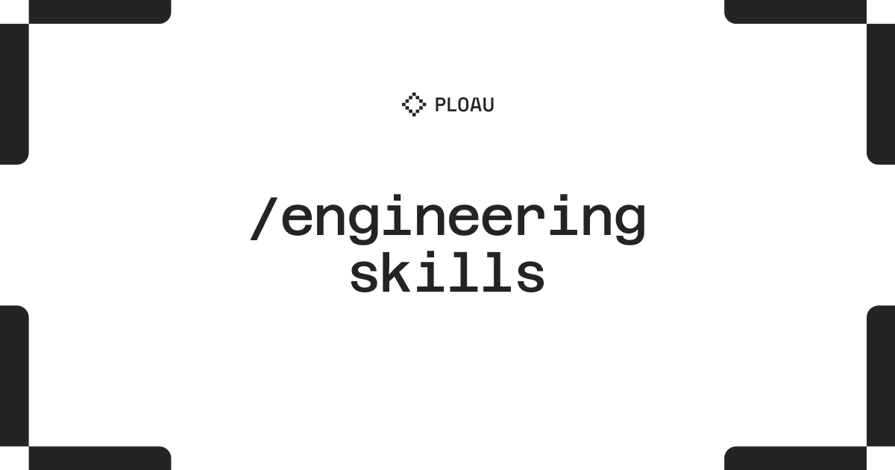

# engineering-skills

Harness-agnostic skills for the project that is open and the harness that is already running. Skill files describe the outcome and the evidence.


Install the skills from this repo:

```bash
npx skills add ploau/engineering-skills
npx skills add ploau/engineering-skills --skill <skill-name>
```

## Skills

| Folder | Invocation | Description |
| --- | --- | --- |
| `skills/auto-task/` | `/auto-task` | Turns incoming requests into durable, independently scoped implementation tasks and keeps working until every queued task is complete. |
| `skills/create-agents-md/` | `/create-agents-md` | Writes or updates the short harness agent guide for the open project, capped at 15 concepts. |
| `skills/create-dx/` | `/create-dx` | Organizes the open project so it is easier to read, trace, maintain, and scale. |
| `skills/create-feature/` | `/create-feature` | Builds the feature the user named in the open project, after the project organization step. |
| `skills/create-plan/` | `/create-plan` | Interviews the user and writes an implementation plan for the current request. |
| `skills/create-release/` | `/create-release` | Plans the release commits, writes Changesets notes, applies them to the changelog and version, creates the git tag, and pushes that commit and tag. |
| `skills/git-plan/` | `/git-plan` | Plans the branch, commits, and exclusions for the current change. A release version bump is one commit in that plan. |
| `skills/improve/` | `/improve` | One-pass analysis of the current plan's feature diff. |
| `skills/record-it/` | `/record-it` | Records a UI flow with the recorder the current harness exposes, into `.recordings/NNN-slug/` (`report.md` plus a video file) on the feature branch that owns the work. |
| `skills/skill-to-plugin/` | `/skill-to-plugin` | Generates a harness plugin from a skill using the local templates in this repo. |
| `skills/stress-it/` | `/stress-it` | Stress-tests the current project's UI in the browser the current harness exposes, then mines the console and the newest project debug or session logs for render loops and runtime errors. |
| `skills/test-it/` | `/test-it` | Creates and executes a real UI test for the current task in the browser the current harness exposes. |
| `skills/writing-review/` | `/writing-review` | Reviews or rewrites technical prose in the language of that prose. |
