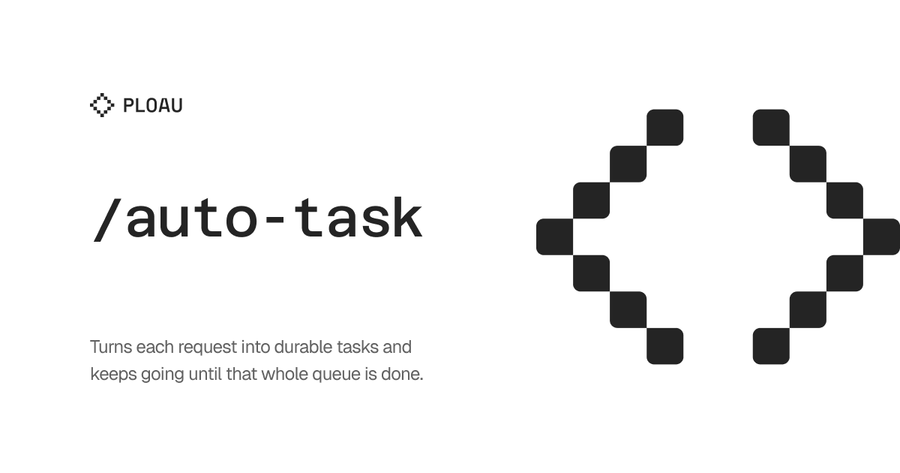

## User language

Chat replies, and the prose of any report this skill writes, use the user's language. Infer that language from the conversation, or from the text after the command. Keep each paragraph of that output in one language. When this skill names a heading that another skill has to find, keep that heading text as specified and write the body in the user's language. The instructions in this file stay in English.

# Auto Task

Use this skill to convert an incoming request into one or more clear tasks and carry **every** task to a verified `complete` outcome in this session. The workflow is durable across turns, but a turn that finishes only the first task is not done. Keep each task’s original scope intact; do not merge them, and do not pause the queue because one unit is finished.

## Core contract

1. Identify every independent deliverable in the input.
2. Create one task unit per deliverable. Do not merge unrelated changes merely because they affect the same project.
3. Keep separate task records **on the current feature branch** (see **Branch-local archive**). Do **not** stop, hand off, or wait for a new chat after creating or completing one unit. Execute the full queue in this session unless the user explicitly says to pause or to split remaining work into another chat.
4. Inspect the current project, runtime, content model, and visual patterns before choosing where to implement.
5. Use the structured question tool the current harness exposes for every ambiguity that could materially change scope, content, UX, data modeling, or implementation. If that tool is missing, ask in chat. Present at least two concrete options and mark one as `(Recommended)`. After the user answers, resume the queue immediately.
6. Never fabricate missing URLs, files, copy, credentials, or external state. Represent them as blockers or editable fields.
7. Implement the requested scope, not a smaller substitute that only passes a narrow check.
8. Verify every explicit requirement against current-state evidence before declaring **that** task complete, then start the next queued task without waiting to be asked.
9. Stop only when the completion gate in **Queue until all tasks are complete** is satisfied.

## Parse

Extract these from the request:

- Deliverables: the user-visible outcomes, files, fields, or behavior requested.
- Inputs: text, images, links, files, recordings, or referenced external material.
- Constraints: existing design patterns, accessibility, responsive behavior, CMS/editor workflows, security, and compatibility.
- Decisions: choices that require user input.
- Dependencies: assets, URLs, content, credentials, runtime services, or approvals that are not available.
- Evidence: the tests, rendered output, file inspection, runtime behavior, or external confirmation that will prove completion.
- Test cases: the `/test-it` contract. Each task that changes UI or a user-visible flow must include a `## Test cases` checklist. Every item has a Goal (what it proves), a Task (what `/test-it` does), and Passes when (the observable result). The task record stays in `.tasks/`. `/test-it` writes the Result, the report, and the screenshots under `.tests/`. Do not copy that evidence into the task folder.

If the input contains several unrelated deliverables, state the task split explicitly before implementation:

```text
Task 1 — [short outcome]
Task 2 — [short outcome]
```

If the request has no actionable objective, ask the user to provide one rather than creating an empty task.

### Invoked from `/stress-it` finalization

`/stress-it` calls this skill **only after** `.stress/NNN-slug/report.md` is
written, never during the battery. One task folder per finding. Do **not**
implement product source in that same stress turn unless the user explicitly
asked to fix. Fix tasks stay `pending`. Working-as-designed unhappy results
get one `complete` record whose outcome is no product change.

Do **not** paste a Stress disclaimer into every `report.md`. Put the
preservation contract (happy path already worked; do not break it) in
`.tasks/README.md` once. Each stress task report: one line `See: ../README.md`.
**Read `.tasks/README.md` once per session**, then only unique sections of
each `NNN-slug/report.md`. If the README is missing, write it (host defaults,
how to read a report, stress contract in this project’s words).

## Queue until all tasks are complete

Build the queue before implementing:

1. Every task unit parsed from the current request (including new `.tasks/NNN-slug/` folders you create).
2. When the repo already has `.tasks/`, every existing `report.md` that is not finished: `status` is `pending`, `in-progress`, or `blocked` with a blocker you can clear. Empty Result lines in the task record are expected. `/test-it` fills those results in `.tests/`, not in this folder. **Exception:** a `/stress-it` finalization turn only creates or updates **stress-derived** folders from that run’s `## Findings`. Do not drain unrelated older `.tasks/` (other features) in that turn.
3. Any deliverable that was implemented without a task folder (create the missing numbered folder, then finish it).

Work the queue in numeric `.tasks/` order, then any remaining request-only units. After each unit passes its completion audit, update that `report.md` to `complete` and **immediately** start the next. Do not end the turn with “task created” or “one task complete” while others remain.

A task is finished only when `status: complete`, every acceptance criterion is checked, every `## Test cases` item in the task record has Goal, Task, and Passes when, and verification evidence is filled. UI evidence from `/test-it` lives in `.tests/NNN-slug/`, not in the task folder. Skipped cases without user acceptance keep the task in the queue.

**Stop the session only when:**

- every queued task is finished as above, or
- every still-open task is a user-only blocker (`Missing input` or `External authorization`) that you already asked about and cannot proceed without.

Unavailable environment: start or repair what you can, keep other tasks moving, and retry the blocked task in the same session. Do not treat “one task is blocked” as permission to stop the rest of the queue.

Do not use a compact handoff, a summary-only reply, or “open items for later” while any unblocked task remains.

## Start

For each task:

1. Restate the task in outcome-oriented language.
2. List the deliverables, acceptance criteria, and `/test-it` checklist (Goal, Task, Passes when) for the primary URL, related routes, empty/error states, and viewports.
3. Inspect the repository and identify the existing implementation point.
4. Compare nearby UI, content, and code patterns before introducing a new one.
5. Ask focused questions for unresolved decisions. Keep questions grouped, concrete, and easy to answer.
6. Record the recommended path and why it preserves the current system.
7. Implement the smallest complete design that satisfies the task, including data entry and fallback behavior where appropriate.
8. Validate immediately with the strongest available evidence.
9. Mark the task complete in `report.md`, then start the next queued task in the same session.

For a UI or website request, inspect at least:

- The target template/component and its data source.
- The nearest page or component with a similar visual role.
- Shared layout, typography, color, button, spacing, and responsive rules.
- CMS fields, seed data, or configuration used to populate the content.
- Existing accessibility and external-link conventions.

Prefer extending an existing component pattern over creating a parallel visual language. A new section is appropriate only when its information architecture is distinct and it can be introduced without changing unrelated sections.

## Questions

Use the harness question tool when it exists. Otherwise ask in chat, in the user's language. Do not silently select a material choice. Every question must:

- Describe one decision.
- Offer at least two viable options.
- Put the preferred option first and suffix it with `(Recommended)`.
- Explain the consequence through the option label when useful.
- Avoid asking for information already present in the request or repository.

Typical decisions include:

- Existing section versus new section.
- Inline content versus a reusable component.
- Hardcoded copy versus CMS-managed fields.
- External URL versus locally hosted asset.
- One CTA versus a CTA group.
- Preserve current behavior versus migrate old content.

If a safe default is obvious and reversible, use the recommendation after asking. If the decision is destructive, irreversible, security-sensitive, or blocks the requested outcome, wait for the answer.

## Design and implementation decisions

Before coding, write a compact decision record for the task:

```text
Design:
- Placement: [existing section or new section]
- Pattern reused: [component/page/style pattern]
- Responsive behavior: [mobile and desktop behavior]
- Accessibility: [heading hierarchy, labels, focus, contrast, external links]

Implementation:
- Template/component: [path]
- Styles: [path]
- Content model: [fields/configuration]
- Assets: [paths or pending inputs]
- Backward compatibility: [fallback or migration behavior]
```

For content the current project already models:

- Put editable content in that project's content model, templates, and components when people need to update it.
- Keep field identifiers stable when changing their presentation.
- Add new fields rather than destroying existing values when migration is uncertain.
- Escape output according to context: text, HTML, URL, attribute, or media source.
- Hide optional UI when its required content is absent rather than rendering broken links.
- Use local assets for files that must be downloadable directly. Do not substitute an editor-only remote folder unless the user asked for that.

For external links:

- Validate and escape the URL at output.
- Use `target="_blank"` only when appropriate and pair it with `rel="noopener noreferrer"`.
- Keep the link label descriptive and distinguish navigation from download.

## Task record

Maintain a concise record for each task. **Always** create `.tasks/` at the git repository root of the scoped package. Each task is a numbered folder, not a loose Markdown file:

```text
.tasks/001-add-minicourse-location/
  report.md
  screenshots/
```

Use a three-digit prefix (`001`, `002`, …) from the next free number in `.tasks/`, then a lowercase kebab-case outcome slug. Keep `report.md` as the task record. `/test-it` screenshots go in `.tests/NNN-slug/screenshots/` with kebab-case names that match the checklist item (`banner-content.png`). Do not store that test evidence in the task folder. Keep task records separate from source code and editorial content.

## Branch-local archive (required)

`.tasks/` is the durable record of work **on the branch where that work happens**. It is **not** product source. Never land `.tasks/`, `.tests/`, or `.recordings/` on `main` / `master`.

### Which branch

1. Resolve the git repo that owns the work. If the workspace contains nested repositories, use the one whose tree contains the files you are changing. All `.tasks/` paths are relative to **that** repo.
2. If `HEAD` is `main` or `master`, **do not** commit tasks there. Create or check out a feature branch first (`feat/…`, `fix/…`, `improve/…`). If the user already named a branch, use it.
3. If this workstream **creates or switches to a new branch**, copy or continue `.tasks/` **on that new branch** and commit there. Do not leave the only copy on a different branch, and do not merge tasks into `main` so they “follow” the code.
4. Each branch keeps its own `.tasks/` history. Do not drain another branch’s task queue, and do not delete another branch’s folders to “clean main.”

### Save on the branch

Whenever you create or update `.tasks/NNN-slug/` (including `report.md` and `screenshots/`), or `/test-it` writes `.tests/`, or `/record-it` writes `.recordings/`:

1. Stay on the feature branch.
2. `git add .tasks/`. Add `.tests/` only when this branch’s `/test-it` output belongs with those tasks. Add `.recordings/` only when this branch’s `/record-it` output belongs with those tasks.
3. Commit on **that branch only**, for example `chore(tasks): record NNN-slug`. Do not mix task screenshots into a product `feat:` commit unless the user asked for a single commit.
4. **Push the feature branch** (`git push -u origin HEAD`) so the archive survives a local branch delete. Leave `origin/<branch>` in place; that remote is the record, same as code review branches after squash.

If the user has not asked to commit product code, still commit **task records** on the feature branch so they are not stranded in the working tree. Do not commit secrets, `.env`, or unrelated dirty product files in that tasks commit.

### Never merge to main

When landing the feature (squash, merge, `/create-release`, PR):

- Stage **product** paths only.
- Do **not** `git add .tasks/`, `.tests/`, or `.recordings/` onto `main`.
- If a squash/index accidentally includes them, `git restore --staged .tasks/ .tests/ .recordings/` before the main commit.
- After squash-merge to `main`, **delete the local feature branch only**. Keep `origin/<feature-branch>` so `.tasks/` remains inspectable.

`main` may show untracked `.tasks/` from a leftover working tree. Leave them untracked or check them out on the feature branch (`git checkout <branch> -- .tasks/`). Never `git add .tasks/` on `main`.

## README.md (orchestrator)

`.tasks/README.md` is the shared contract. Agents Read it **once** per
session. It holds: archive rules, status vocabulary, default host/viewports,
and (when this branch has stress work) the preservation contract. `/test-it`
writes its report index in `.tests/README.md`, not here. Do not duplicate
those paragraphs in `NNN-slug/report.md`.

Create the README when creating `.tasks/` if it does not exist. Point new
reports at it with `See: ../README.md`. Omit empty `## Blockers`. Omit
Primary URL / related routes / viewports when they match the README defaults.

## report.md

`report.md` must use valid YAML frontmatter, one H1 matching `title`, and
**unique** H2 sections only (Objective, Inputs, Decisions, Implementation,
Acceptance, Test cases that are not the default host). Template:

```markdown
---
id: add-minicourse-location
title: Add minicourse location
status: in-progress
created: YYYY-MM-DD
updated: YYYY-MM-DD
---

# Add minicourse location

## Objective
[One sentence describing the outcome]

## Inputs
- [input and source]

## Decisions
- [decision]: [selected option]; recommendation rationale

## Implementation
- [file/component]
- [content model or asset]

## Acceptance criteria
- [ ] [criterion]

See: ../README.md

## Test cases

Host/viewports: README default (only override if this task differs)

- [ ] **[Case name]**
  - Goal: [what this case exists to prove]
  - Task: [navigate, click, submit — the user-like actions `/test-it` will run]
  - Passes when: [visible copy, destination URL, attribute, or absent control]
  - Result:
  - Screenshot:

## Test results

- Last run: not run
- Source: —
- Notes: —

## Verification evidence
- [command, file, rendered page, or runtime observation]
```

`## Test cases` is the `/test-it` contract. Write the checklist from the requested outcome before implementation. Every user-visible flow, CTA, related route, and empty/error state in the acceptance criteria must appear as an item with Goal, Task, and Passes when. Leave Result and Screenshot empty in this task record. Do not invent URLs, files, or copy in the cases.

`/test-it` runs those items as a user would and writes the checked list, Result (pass, fail, or skipped plus evidence), screenshots, and `## Test results` under `.tests/NNN-slug/`. A screenshot alone is not enough; the interaction still has to happen. Do not copy that report into `.tasks/`.

Keep status values consistent: `pending`, `in-progress`, `blocked`, or `complete`. Update `updated` whenever the record changes. Do not put secrets in task records. If `.tasks/` already exists **on this branch**, preserve unrelated folders and migrate a loose `.md` into `NNN-slug/report.md` rather than leaving both. Always create `.tasks/` when this skill runs (including `/improve` Autotask folders). Persist them with the **Branch-local archive** rules above — on the feature branch, pushed, never merged to `main`.

## Blockers and continuation

Classify blockers:

- `Missing input`: the user must provide a file, URL, copy, or decision.
- `Unavailable environment`: a required local service or tool is not running.
- `External authorization`: access is denied; confirm once, mark that task `blocked`, and continue every other queued task. Do not stop the session unless the entire remaining queue depends on that access.
- `Verification gap`: implementation exists but the required evidence has not been collected.

Continue all non-blocked work in the same session. Make the missing dependency visible in the UI model when that is part of the requested outcome, but do not publish placeholders as final content unless the user selected that option.

When the user answers a question, update the affected task, then continue the rest of the queue. Preserve unrelated task scope and decisions. Answering a question is not a stopping point.

## Completion audit

Before declaring **one** task complete:

1. Derive a checklist from the original request, including every named artifact, field, CTA, section, command, and constraint.
2. For each checklist item, identify authoritative evidence.
3. Inspect the current files and run relevant validation, build, lint, or runtime checks.
4. Verify the rendered behavior when the task changes UI. `/test-it` must execute the checklist in `.tasks/NNN-slug/report.md` and write the report plus screenshots under `.tests/NNN-slug/`. A screenshot-only pass is not enough. Do not write that evidence into the task folder.
5. Confirm missing assets and blockers are either resolved or explicitly reported.
6. Confirm no unrelated files or behavior were changed.
7. Report what changed, what was verified, and what remains blocked **for this unit only if the full queue is finished or fully user-blocked**.
8. If another queued task is still open and unblocked, do not report a session-complete handoff. Start that task next.

Evidence strength must match the claim. A passing syntax check does not prove responsive layout, and a file existing does not prove that a page renders it.

## Response format

Use this compact structure **only after the queue gate is met** (every task complete, or every leftover is a user-only blocker already asked):

```text
Queue: [complete | blocked on user]

Tasks:
- [name]: [complete | blocked] — [one-line outcome]

Files:
- [path]: [purpose]

Verification:
- [evidence]

Open items:
- [user-only blocker or “None”]
```

Do not emit this handoff after creating records or finishing a subset. Repeat one bullet per task; statuses stay independent, but the reply waits until the queue is drained.
