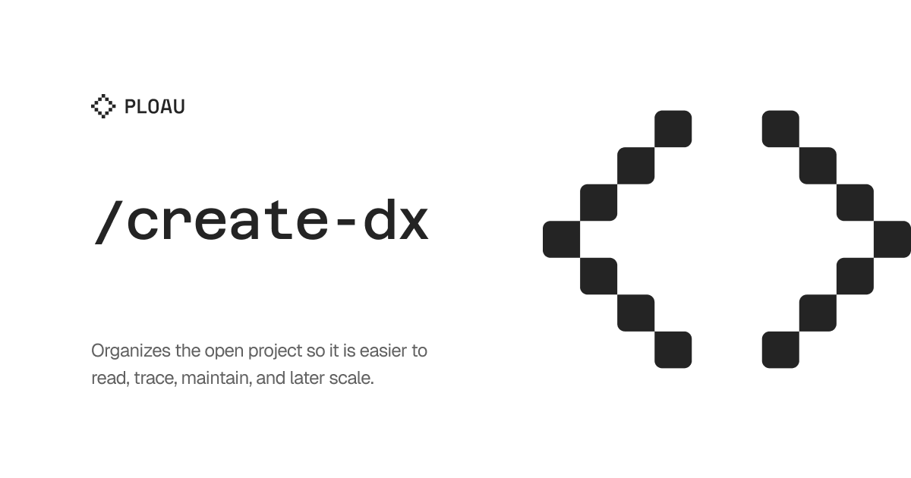

## User language

Chat replies, and the prose of any report this skill writes, use the user's language. Infer that language from the conversation, or from the text after the command. Keep each paragraph of that output in one language. When this skill names a heading that another skill has to find, keep that heading text as specified and write the body in the user's language. The instructions in this file stay in English.

# Create DX

Organize the open project. An organization record is a file in that project that already states folder layout, naming, and how imports resolve. Detect it from the project. Do not ask the user to name this skill.

Use the files and layout the project already has. Do not add a stack the project does not have. Do not mention another project.

Decision criteria for every option: the project becomes easier to read, trace, maintain, and scale.

## Automatic mode

Run this mode when another skill or the start of work calls this skill and the project has no organization record yet.

1. Detect the current layout. Read the project manifest (name, scripts, dependencies), language and path config if present, where source and shared code already live, linter and formatter config if present, and how existing files are named.
2. Recommend one organization that fits what you detected. Show the folder shape, the naming rules, and the import rule in the project's own terms. Mark it `(Recommended)`.
3. Ask whether they accept it or want to adjust it. Ask at most three questions. Confirm before writing. Do not assume.
4. Write one artifact. If the project has no docs home, write `DX.md` at the project root. If it already keeps conventions in one doc, add them there instead of a second file.

The artifact states the philosophy in short lines, the folder structure, a naming table drawn from files that exist, the import pattern the project can already resolve, and the component or module pattern the project already uses. Include a linter rule only when a linter config already exists and the user accepted that rule.

## Manual mode

When the user invokes `/create-dx`, do not generate `DX.md` by default.

1. Detect the same facts as automatic mode.
2. Present concrete organization possibilities for this project. Each option names the single artifact it would write or update. Recommend one. Judge every option by whether the project becomes easier to read, trace, maintain, and scale.
3. After they choose, write only the artifact that option needs. Do not also write the artifacts of the options they declined.

## Questions

Use the question tool the current harness exposes. If that tool is missing, ask in chat. Offer concrete options and mark one `(Recommended)`. Stop at three questions.
