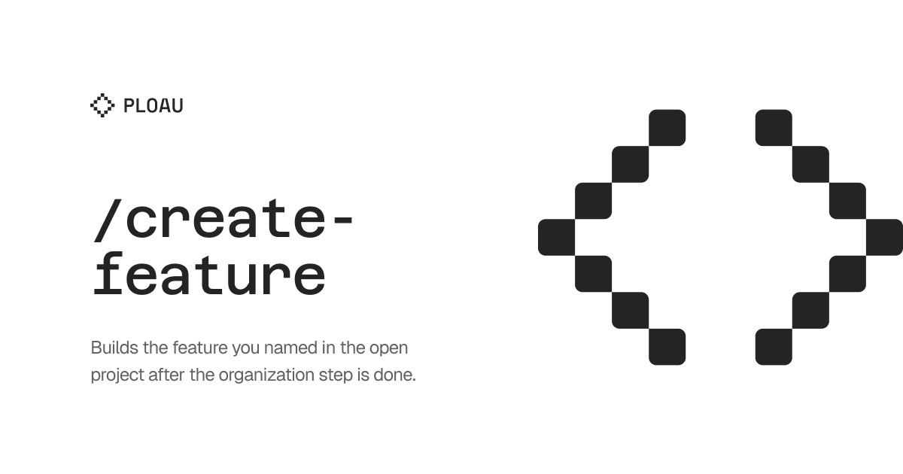

## User language

Chat replies, and the prose of any report this skill writes, use the user's language. Infer that language from the conversation, or from the text after the command. Keep each paragraph of that output in one language. When this skill names a heading that another skill has to find, keep that heading text as specified and write the body in the user's language. The instructions in this file stay in English.

# Create Feature

Build the feature named after `/create-feature`. The text after the command is also a language signal. Scope stays this feature. Other dirty files in the repo are not part of it.

## Organize first

Before or as part of creating the feature, follow [skills/create-dx/SKILL.md](../create-dx/SKILL.md). If the project has no organization record yet, that skill runs in its automatic mode. Do not paste the create-dx procedure into this file. Do not ask the user to name create-dx.

## Build

1. Restate the feature in one sentence, in the user's language.
2. Put new files in the layout the organization record settled. Match names and imports that record already states.
3. Match patterns the project already uses. Do not add a stack the project does not have.
4. Ask only when a choice would change the feature. Use the question tool the current harness exposes. If that tool is missing, ask in chat. Mark one option `(Recommended)`.

## Done

The organization step has run, or an organization record was already in the project. The feature files are in that layout. Name the files you added.
