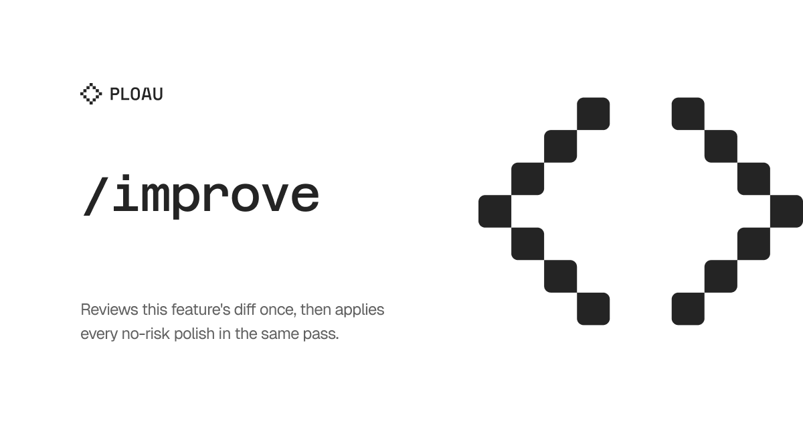

## User language

Chat replies, and the prose of any report this skill writes, use the user's language. Infer that language from the conversation, or from the text after the command. Keep each paragraph of that output in one language. When this skill names a heading that another skill has to find, keep that heading text as specified and write the body in the user's language. The instructions in this file stay in English.

# Change-set analysis (battery, then no-risk apply)

Staff-level analysis of **this feature** (the plan in this chat, plus the files that plan created or changed). Run the evidence battery first, classify every item, then **execute every no-risk go item in the same `/improve`**. Do not wait for a blanket yes.

A second `/improve` on an **unchanged** tree must not invent a new class of finding. The classes are typecheck, tests, host resolve, package exports, deleted-symbol imports, and the build the project actually ships. If a second pass would invent one of those, the first pass was incomplete. Sampling git and skipping the battery is a failed `/improve`.

## Hard rules

- Battery and classification happen **before** any product edit. Do not edit while still discovering.
- **No-risk, always apply:** `Decision: go`, not marked **dangerous**, not **no-go**. Dead files, unused exports, imports that reach into another package's private source, comments, tests that lock current behavior, and host or package-export fixes that restore compile without changing identity keys. Implement these in this turn after Checks run, Broken now, and the item list.
- **Risk, opt-in only:** marked **dangerous**, or any change to persistence keys, runtime identifiers, observer or mutation contracts, or a public API that other packages in this repo consume. Do **not** apply those until the user **names** the letters. A blanket **yes** still does not apply dangerous items.
- **no-go** never applies and **never appears** in the user-facing polish list. Classify internally, then drop it. Padding the report with declined ideas is a failed `/improve`.
- Do **not** commit or push product code unless the user explicitly asks.
- You **must not** clean up files outside the feature set. Creating `.tasks/NNN-slug/` is allowed. Commit and push of `.tasks/` follows the auto-task skill.
- Do **not** drive a browser. `/test-it` reads the task record in `.tasks/` and writes evidence under `.tests/`.

## Feature set (only this plan)

Polish and breakage are about the **plan's feature**, not every dirty file in the repo.

1. Read the plan this chat is executing.
2. Feature files are the paths the plan names, plus `git diff` and untracked files that implement that plan. Include tests, package manifests, and config that aliases those packages.
3. Other dirty files get **one line**: also dirty, not this feature. Do not polish them. Do not use that line as an excuse to skip the battery on the feature set.

If a feature file changes exports, a prebuild, workspace membership, or a host import, the **host the plan uses to prove the feature** stays in the battery even when that host's files are absent from the diff.

## Evidence battery (all of it, before any polish edit)

Discover commands from the open project. Run **every** row that applies. Parallelize. Quote failures. Missing a row that applies means the analysis is invalid. If the project has no such command, record that and do not invent one.

| # | Check | When | What to run or read |
| --- | --- | --- | --- |
| 1 | Git | always | `status`, `diff`, `diff --cached`, and `log -5 --oneline` in the git repo that owns the feature |
| 2 | Typecheck | when the project defines one | The typecheck script, `tsc` entry, or documented check for each package in the feature set |
| 3 | Tests | when the project defines tests | The test script or documented runner for each feature package, including tests whose imports you changed |
| 4 | Build | when the feature ships a build, package export, or generated artifact | The build command that host or publish step actually uses |
| 5 | Package metadata | if a manifest or lockfile in the feature set changed | Exports, files, and any prebuild that wipes build output. New package names must be registered where this repo registers them. Published code must not import another package's private source |
| 6 | Deleted or moved symbols | if files were deleted or public exports trimmed | Search the repo, skipping dependency and build output directories, for old names and old paths |
| 7 | Host resolve | if a running app, page, or embed loads the feature | Read the dev-server or task logs the current harness exposes. Resolve or compile errors are **Broken now**. Confirm the built files that host imports exist after the project's build. Discover the host from the plan and the project |
| 8 | Diagnostics | always | Linter or IDE diagnostics the current harness exposes, on feature files |
| 9 | Plan vs tree | always | Every plan deliverable has a file or an explicit **Broken now**. Do not analyze a subset of the plan |

Do not stop at the first green command. A green typecheck with a red host is **Broken now**.

If another package or app in this repo consumes the feature, that consumer is in the battery even when its files are not in the diff.

## Product stance

The feature is in development unless the user says otherwise. Prefer the better product over an earlier contract. Tests, UX, and host compile on this branch still count.

**go** means a real improvement to this feature. **no-go** means it is not an improvement. `go` is the only polish. If nothing is `go`, the polish section is empty. That is success.

## Autotask (required for `/test-it`)

If the feature has a user-visible flow, create `.tasks/NNN-slug/` (`report.md` plus an empty `screenshots/`) at the git root that owns the feature. Use the next free three-digit id on **this branch**. Follow the auto-task branch-local archive. Do not overwrite unrelated folders. That folder is the task record. `/test-it` writes its report and screenshots under `.tests/`, not into this folder.

`report.md` uses YAML `id`, `title`, `status`, `created`, `updated`; an H1 equal to the title; then Objective, Inputs, Decisions, Implementation, Acceptance criteria, **Test cases**, Test results, and Verification evidence. Omit empty Blockers.

Test cases have Goal, Task, and Passes when, with empty Result and Screenshot. If a dev server URL is already known from the project or a running process, record it. If it is not known, leave it blank and say so. Do not invent a URL. If battery item 7 failed, quote it under Blockers, and do not write cases as if the page loaded.

If this `/improve` applied no-risk items, status is `in-progress` and `/test-it` has not run. If the turn was analysis only, status is `pending`.

## Analysis checklist

Variables, duplication, filler prose, comments, coupling through package exports and prebuild, and regression surfaces where callers or tests were not updated with the change.

## Breakage / regression (required)

Every **go** polish item, every Broken now finding, and every load-bearing area of the feature as it ships needs **What breaks**, **Why**, **How to improve it**, **Investigate**, **If we go with this**, and **Decision: go**. Mark **dangerous** when the item must not auto-apply. If classification is no-go, do not write the item. If it is go and not dangerous, it is no-risk: apply it.

## Output (user-facing)

Write section titles and body prose in the user's language. Lead with **Broken now** when that list is non-empty. After the lists, apply no-risk go items, then say what landed.

### Checks run

One row per battery item: command or log source, pass or fail, and one line of evidence. If a row was skipped, say so. That `/improve` is incomplete.

### Broken now

Quoted failures from the battery. If none, the Checks run table is the proof.

### Recommended polish

Only `Decision: go` items. Each one includes the change, What breaks, Why, How to improve it, Investigate, If we go with this, Decision, and **dangerous** when needed. Tag **applied** when it was no-risk and done this turn, or **waiting** when it is dangerous and opt-in.

If none, one line in the user's language that there is nothing to improve. Do not list no-go items, rejected alternatives, or hypothetical refactors.

### What might break if we change it

Load-bearing areas of the **shipped feature** and of **go** polish, in the same shape, then the tests or checks already in Checks run. Do not restate declined ideas.

### Autotask

Folder path. Remind the user to run `/test-it` after a no-risk apply, and when Broken now is empty or listed as a blocker.

### Ask

Only for **waiting** dangerous **go** items. Ask the user to name the letters to implement. No-risk go items are already done. Do not ask for a blanket yes on those. If polish is empty, omit Ask.
