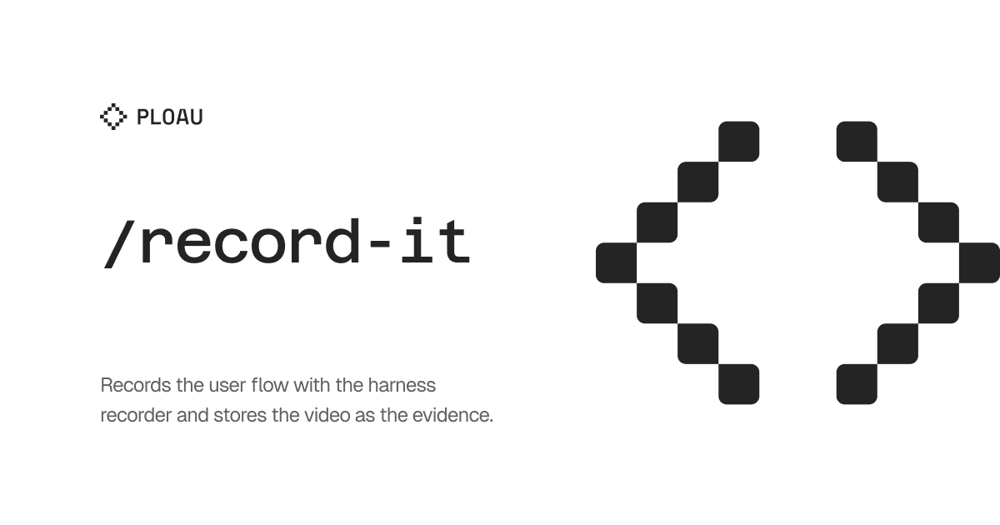

## User language

Chat replies, and the prose of any report this skill writes, use the user's language. Infer that language from the conversation, or from the text after the command. Keep each paragraph of that output in one language. When this skill names a heading that another skill has to find, keep that heading text as specified and write the body in the user's language. The instructions in this file stay in English.

# Record It

Record the flow the user named. If `/test-it` is in the same request, **this skill wins** for where the evidence is stored.

Use the recorder the current harness or the current project already exposes. If no recorder is available, say so and ask. Do not install a product stack as a requirement, and do not treat a screenshot as the recording.

More on discovery: [references.md](references.md). Setup checks: [INSTALL.md](INSTALL.md).

The run list comes from you, or from `.tasks/NNN-slug/report.md` `## Test cases` when that file matches the slug. The recorder only executes that list.

## Parse

Accept `/record-it` plus an optional URL, route, `NNN-slug`, or kebab slug. The text after the command is also a language signal.

- A URL or route is the page.
- `NNN-slug` or a kebab slug is the folder under **`.recordings/`**. Take the page from the matching task `report.md` when it records a URL. Otherwise use the project's known local URL. Otherwise ask. Do not invent a URL.
- An empty argument means ask for a kebab slug. Do not invent a `.tasks/` number.
- If `.tasks/<same-slug>/report.md` has `## Test cases`, that is the run list. Do not invent extra pages or drop a listed item. Evidence still lives only under `.recordings/`. `/test-it` evidence, when that skill runs, lives under `.tests/`.
- After the run, write Result and `## Test results` into **`.recordings/NNN-slug/report.md`**.
- Do not modify project source. Allowed writes are `.recordings/` only.
- Then follow **Branch-local archive**.

## Branch-local archive (required)

`.recordings/` is evidence on the branch where the capture happens. It is not product source. Never land `.recordings/` or `.tasks/` on `main` or `master`.

1. Resolve the git repo that owns the work. All `.recordings/` paths are relative to that repo.
2. If `HEAD` is `main` or `master`, do not commit there. Create or check out a feature branch first. If the user already named a branch, use it.
3. After `report.md`, the video, and `screenshots/` exist, stay on that branch, `git add .recordings/`, commit `chore(recordings): record NNN-slug`, and push when a remote exists. If no remote exists, say so and do not invent one.
4. Do not mix the video into a product commit unless the user asked for a single commit. Do not commit secrets or unrelated dirty product files.
5. When landing the feature, stage product paths only. Unstage `.recordings/` and `.tasks/` if they sneak into the index. After the land, delete the local feature branch only and keep the remote.

`main` may show untracked `.recordings/`. Leave it untracked or check it out on the feature branch. Never `git add .recordings/` on `main`.

## Capture folder

Repo root `.recordings/`:

```text
.recordings/NNN-slug/
  report.md
  session.webm
  screenshots/
.recordings/README.md
```

Use the video extension the recorder actually writes. `session.webm` is the default name when the recorder can write it.

Keepers are the report, the video, and `screenshots/`. Do not add helper scripts next to the video.

Allocate the folder with the skill script, from the directory that contains this skill:

```bash
python3 scripts/recording_dir.py SLUG
```

`NNN` is local to `.recordings/`. The first capture is `001`. Reuse the child when the slug exists. Do not copy `.tasks/` numbers.

## Context index

The first time this skill creates `.recordings/`, before writing any ignore entry, ask in the user's language whether this folder should be indexed in context. Offer two options, recommended first: do not index (recommended), and index. If `.recordings/README.md` already records `index`, do not ask again.

Create `.recordings/README.md` if it is missing. YAML front-matter includes `index: true` or `index: false`, and `created` as a date. Write the body in the user's language. Include a table of links to each report this skill wrote, with columns Path, Title, and Date. Each later run updates that table. Do not copy a report into the README.

If the user declines indexing (`index: false`), exclude the folder from context indexing only. When the harness is Cursor, add `.recordings/` to `.cursorindexingignore` at the git repo root. Create that file if it is missing. Do not add the folder to `.cursorignore`. `.cursorindexingignore` keeps the folder out of the semantic index and automatic context. The agent can still read and update the files by path. `.cursorignore` blocks agent reads. That would break the next run, which must open `.recordings/README.md` and the reports by path. Never ignore the whole repo. Only `.recordings/`.

This run does not need the index. You just wrote the files and still have that content in the conversation. Write the report anyway. Later runs open the README and the report by path. Do not skip the report because the folder is unindexed.

If the user approves indexing (`index: true`), do not add an ignore entry. The front-matter records the approval. If a previous ignore entry for `.recordings/` exists, remove only that entry.

If the harness is not Cursor, ask which index-ignore file the project already uses. Do not invent a second ignore mechanism. If the user declined indexing and no such file exists, record `index: false` and tell the user no index-ignore file was found, so nothing was excluded. Do not create `.cursorignore`.

## Two phases

### Plan (recorder off)

Open the page, wait until it is ready, dismiss blockers that hide the flow, and identify the controls the run list needs. Do not start the recording yet.

### Capture (one uninterrupted take)

Start the recorder, run the planned actions, then stop it before you return to planning in chat. Do not leave the recorder running while you decide the next click.

If the recorder can show a pointer, turn that on. If it has a separate mode that paints numbered boxes or other annotation chrome on the page, leave that mode off for the take.

If the recorder documents a human-paced input mode, use it for pointer actions. Wait until each visible change has landed, then stop the recording before closing the page.

One process should own the interval between start and stop when the recorder is a shell tool. If the harness records inside a browser tool instead, still keep start and stop as one take without a planning turn in between.

## Report

Use the same H2 shape as an auto-task `report.md`. Check `[x]` on pass. Result names the recorder that actually ran. Screenshot is relative to the capture folder. Recording names the video file. `## Test results` includes the date, passed / failed / skipped, and any frame counts the recorder reported.

A screenshot alone is not verification. The video and the interactions are the evidence. The screenshot supports them.

## Completion audit

`.recordings/NNN-slug/report.md` exists, the video file is non-empty, every case has a Result, executed cases have screenshots when the recorder can take them, the capture was a single take, and no helper script sits in that folder. The folder is committed on the feature branch, not on `main`. Push when a remote exists.

If the harness cannot record video, stop and ask. Do not substitute a screenshot and call it a recording.
