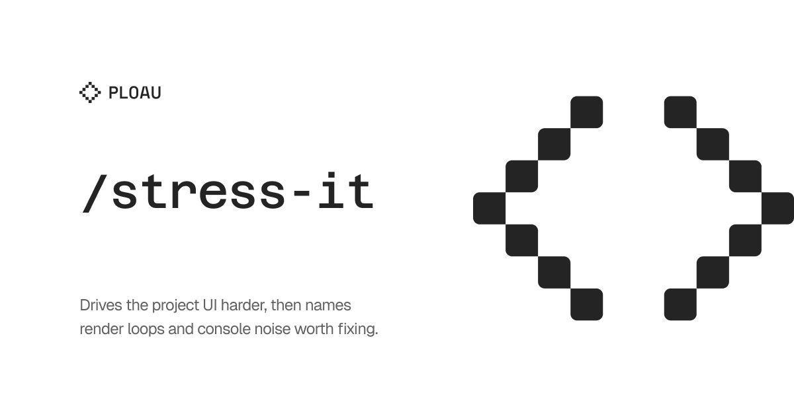

## User language

Chat replies, and the prose of any report this skill writes, use the user's language. Infer that language from the conversation, or from the text after the command. Keep each paragraph of that output in one language. When this skill names a heading that another skill has to find, keep that heading text as specified and write the body in the user's language. The instructions in this file stay in English.

# Stress It

Drive the **current project's** UI the way a user would, but harder and longer than `/test-it`. The goal is not a green feature checklist. The goal is to provoke update loops, animation or overlay storms, and console noise, then name problems that can be fixed in a later turn.

Use the browser, console, and logs the current harness exposes. If a capability is missing, say so and ask. Do not invent a browser, a model, a port, or a product path.

Default host: the current project's primary local URL when that URL is already known from the project or a running process. Otherwise ask. Do not invent a URL.

Do not stop after planning. Perform the first concrete browser step in the same turn when a browser is available.

## Parse

Accept `/stress-it` plus an optional URL, route, or named focus. The text after the command is also a language signal.

- If the argument is a URL or route, that is the target.
- If it is empty, stress the known primary local URL, or ask.
- A named focus (a screen, flow, or control the user named) narrows the battery. If omitted, run the generic UI battery below.
- Do not treat a product-specific hotkey or widget as the default path. If the project documents a shortcut, read that source before pressing it.

## Start (browser)

1. Discover the browser tools the current harness exposes. If none exist, stop and ask.
2. List live tabs first. That list is the only authoritative tab source. Ignore a conversation-context view id that is absent from the list.
3. If a live tab already shows the project host, lock that tab before interacting when the harness has a lock. Do not spawn extras.
4. If you must open a tab, open it, then lock if locking exists, then read the page.
5. Release the lock only when all browser work for this run is done.

If the same browser action fails, retry once only with new evidence. Then stop and ask. Do not invent a second browser.

## Capture setup (before the battery)

If the harness can evaluate script in the page, inject a console buffer. Keep it idempotent. Do not assume a host component file exists.

```js
(() => {
  if (window.__stressIt) return "ready";
  const buf = [];
  window.__stressIt = { t0: Date.now(), buf };
  const wrap = (level) => {
    const orig = console[level].bind(console);
    console[level] = (...args) => {
      const text = args
        .map((a) => {
          try {
            return typeof a === "string" ? a : JSON.stringify(a);
          } catch {
            return String(a);
          }
        })
        .join(" ");
      if (
        /maximum update depth|too many re-renders|warning:|error:/i.test(text) ||
        level === "error"
      ) {
        buf.push({ level, text: text.slice(0, 2000), at: Date.now() });
      }
      return orig(...args);
    };
  };
  ["log", "info", "warn", "error", "debug"].forEach(wrap);
  return "armed";
})()
```

If the page already exposes a render-scan API, you may enable per-render logs for the run and restore the previous options after the dump. If that API is missing, continue. The console wrap still keeps matching lines. Do not edit product source to enable a scanner.

If the harness cannot evaluate script in the page, use the console or log surface it does expose. If it exposes neither, say so and ask. Still run the interaction battery when the browser itself works.

## Generic UI battery

Derive bursts from the app that is actually loaded (navigation, menus, dialogs, lists, forms, overlays). Repeat each burst 8 to 20 times unless the page dies. Prefer pointer and keys over waiting.

1. **Idle load.** Land on the target URL. Read the page. Note chrome that should exist.
2. **Navigate.** Rapid route, tab, or section switches that the app exposes. Return to the start URL between bursts when that is cheap.
3. **Click.** Hit primary controls, secondary actions, empty regions, and overlays. Open, then close, the same surface.
4. **Toggle.** Any mode, sidebar, panel, or switch visible on the page. Rapid on, off, on.
5. **Scroll.** The page, nested scrollers, and sticky or fixed regions if present.
6. **Type.** Focus a text field if one exists. Type, delete, blur. Do not submit a destructive form unless the user asked.
7. **Resize** when layout or overlays depend on viewport. Use a representative desktop width and a narrower width.

If the user named a focus, spend most bursts there and keep one idle burst and one navigate burst.

If a burst triggers a maximum update depth, too many re-renders, or a frozen tree, stop that burst. Record the last actions. Do not keep clicking into a dead tree.

Prefer a short poll of the page over a long sleep.

## Collect logs

### Console

Dump the buffer if you armed one. Also read any visible scanner copy on the page. Classify:

| Signal | Treat as |
| --- | --- |
| `Maximum update depth exceeded` | **P0** render loop |
| `Too many re-renders` | **P0** |
| Uncaught exceptions in app or runtime bundles | **P0** or **P1** by user impact |
| One app component re-rendering through idle or a single gesture | **P1** |
| A dependency-outdated notice | **P3** unless it coincides with a loop |

Turn scanner logs back off after the dump if you enabled them.

### Debug or session logs

Discover the newest ingest or session log for the **current** project. Do not require a hardcoded package path. List by mtime, read only the newest file, and tail it. See [log-patterns.md](log-patterns.md).

If none exist, say so. Do not hunt leftover sessions or ingest an editor debug log wholesale.

Look for the same message exploding, tick or overlay messages with no idle, and counts that never stabilize.

## Findings, not product edits

`/stress-it` does **not** patch product source. It writes a report. Product fixes happen only through auto-tasks created at finalization, not during the battery.

## Auto-tasks at finalization only

Do **not** create `.tasks/` mid-battery, after a single burst, or when the run dies before `report.md` exists.

Create tasks only when the battery finished or died with a recorded P0, the console was collected or confirmed unavailable, the newest debug log was tailed or confirmed missing, and `report.md` is written with findings.

Then follow `/auto-task` once, on the **feature branch** of the stressed app repo:

1. One `.tasks/NNN-slug/` per distinct finding in `## Findings`.
2. Skip a new folder only if this branch already has a task whose objective is the same finding. Link that id in `report.md`.
3. A working-as-designed unhappy result still gets one folder whose outcome is to leave the product unchanged. Mark that record `complete`. Do not paste a disclaimer into that report.
4. Real fix tasks stay `pending`, or `in-progress` only if the user asked to implement in this same message. The stress turn does not start product patches unless the user explicitly asked to fix.
5. Shared text lives in the README, not in each report. If `.stress/README.md` or `.tasks/README.md` is missing, write it in this project's words: how to read a report, and the stress preservation contract. If a host URL is known, record it there. Do not invent one. Read each README once this session. Each `NNN-slug/report.md` stays unique. One line `See: ../README.md` is enough. `.stress/README.md` also follows **Context index**.
6. Fill unique `## Test cases` in the `.tasks/` record for later `/test-it`. Leave Result and Screenshot empty in that task record. `/test-it` writes the run under `.tests/`, not into `.tasks/`.
7. Commit `.tasks/` and new READMEs on the feature branch. Push when a remote exists. Do not mix product source. Never land `.tasks/` or `.stress/` on `main` or `master`.

## Report folder

Write under the git repo that owns the stressed app, not the skill directory.

`.stress/NNN-slug/` on the feature branch. Never land `.stress/` on `main` or `master`.

Create `screenshots/` if missing. Copy tool temp screenshots into that folder when the harness writes them to temp. Keep `report.md` short. Orchestration lives in `.stress/README.md`. Follow **Context index** before you write an ignore entry.

```markdown
# Stress NNN-slug

- Date:
- Source: (the browser or log surface this harness actually used)
- URL:
- Battery: generic | (named focus)

## Findings
- P0/P1/P2/P3: title
  - Evidence: console line or debug-log topic, plus location
  - Likely area: file or module
  - Fixable?: yes/no, plus why

## Console (filtered)
## Debug log (newest file only, tail)
## Battery notes
```

If `HEAD` is `main` or `master`, do not commit there. Create or use a feature branch before `git add .stress/`. Commit message: `chore(stress): NNN-slug`. Push when a remote exists. If there is no remote, say so. Do not mix product files.

## Context index

The first time this skill creates `.stress/`, before writing any ignore entry, ask in the user's language whether this folder should be indexed in context. Offer two options, recommended first: do not index (recommended), and index. If `.stress/README.md` already records `index`, do not ask again.

Create `.stress/README.md` if it is missing. YAML front-matter includes `index: true` or `index: false`, and `created` as a date. Write the body in the user's language. Keep the orchestration prose in that body (how to read a report, and the stress preservation contract). Include a table of links to each report this skill wrote, with columns Path, Title, and Date. Each later run updates that table. Do not copy a report into the README.

If the user declines indexing (`index: false`), exclude the folder from context indexing only. When the harness is Cursor, add `.stress/` to `.cursorindexingignore` at the git repo root. Create that file if it is missing. Do not add the folder to `.cursorignore`. `.cursorindexingignore` keeps the folder out of the semantic index and automatic context. The agent can still read and update the files by path. `.cursorignore` blocks agent reads. That would break the next run, which must open `.stress/README.md` and the reports by path. Never ignore the whole repo. Only `.stress/`.

This run does not need the index. You just wrote the files and still have that content in the conversation. Write the report anyway. Later runs open the README and the report by path. Do not skip the report because the folder is unindexed.

If the user approves indexing (`index: true`), do not add an ignore entry. The front-matter records the approval. If a previous ignore entry for `.stress/` exists, remove only that entry.

If the harness is not Cursor, ask which index-ignore file the project already uses. Do not invent a second ignore mechanism. If the user declined indexing and no such file exists, record `index: false` and tell the user no index-ignore file was found, so nothing was excluded. Do not create `.cursorignore`.

## Completion

Complete when the battery ran or died with a recorded P0, the console buffer was collected or confirmed unavailable, the newest debug log was tailed or confirmed missing, `report.md` lists findings with evidence, the evidence source is named, and one auto-task folder exists per distinct finding or a same-finding task on this branch is linked. If a lock was taken, release it.

If the browser or the logs are missing, say so and ask. Do not claim the battery passed.
